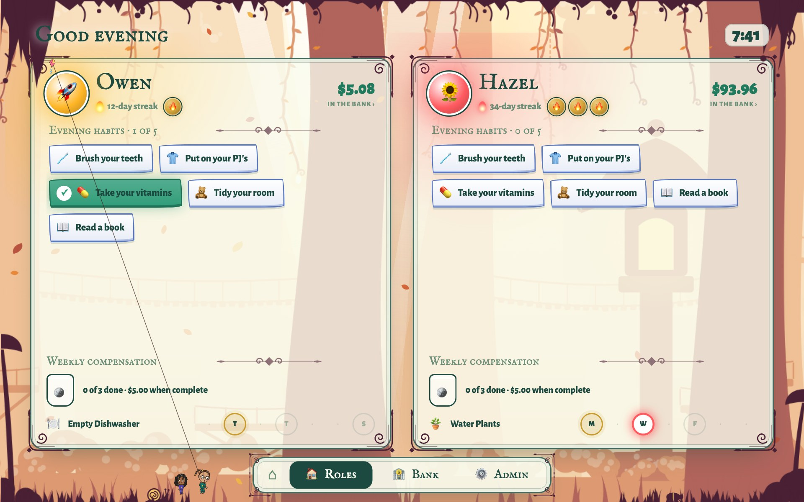
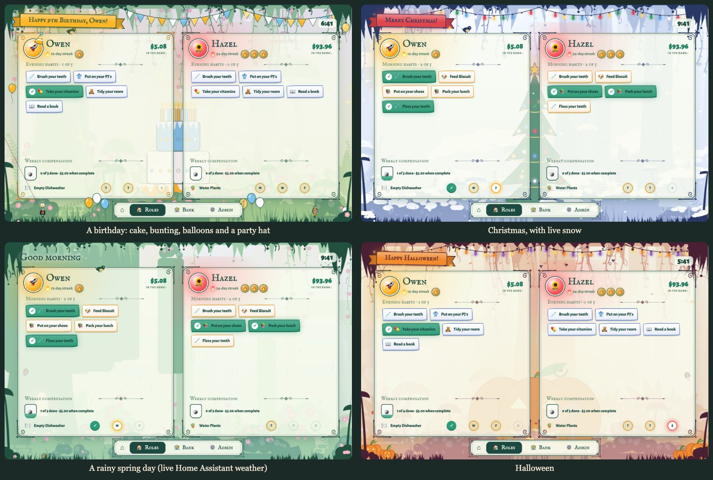
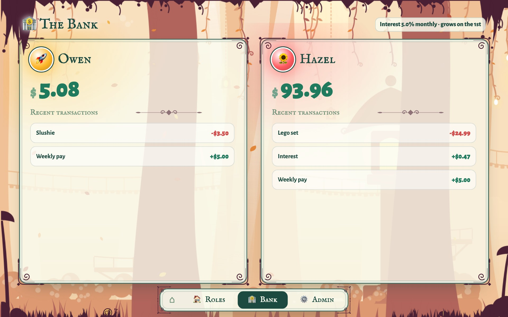
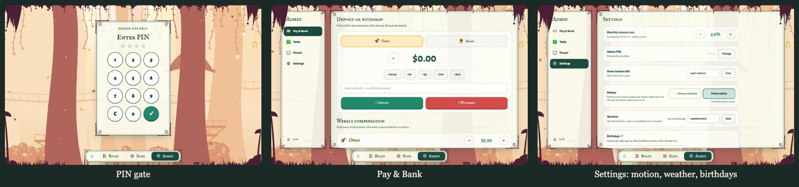

<picture>
  <source media="(prefers-color-scheme: dark)" srcset="brand/lockup-horizontal-dark.svg">
  
</picture>

**Accountability meets personal finance — a Home Assistant integration that helps kids contribute to family life and learn real money skills along the way.**



EarnKeep is built on a simple idea borrowed from Montessori education and Holacracy: children are capable contributors, not passive recipients. Instead of *chores* with *allowances*, kids hold **accountabilities** — meaningful roles in the household — and receive **compensation** for fulfilling them. It's not about compliance. It's about contribution, ownership, and learning that value creation earns value in return.

It's built for a wall-mounted tablet in the kitchen, where kids check off their own day. Behind the cards is a hand-drawn-feeling world that is different every morning.

## A living world, different every day

The UI sits inside a layered 2D scene with parallax depth, light shafts, drifting motes and small critters. All of the art is generated by code.

- **A new place every day:** forest, mushroom wood, lantern hall, lakeside, crystal cave, garden ruins or canopy walkways. Each day also gets a landmark: a giant tree, a waterfall, a rope bridge, a stone lantern, a crystal arch or a lily pond. Neither repeats two days in a row, and every scene stays put all day.
- **Seasons:** spring blossoms, summer gold, falling autumn leaves and winter snow caps.
- **Live weather:** your HA weather entity drives rain, snow, fog, lightning and wind, plus fireflies after dark.
- **Critters:** a bird perches on a kid's card, a snail or beetle crawls by the dock, and butterflies, moths or bats fly through, depending on the season, the weather and the hour.
- **Birthdays:** a banner with the age, bunting, balloons, a giant cake with candles, and a party hat on the birthday kid's avatar, with fireworks after dark. Siblings born on the same day share one party. The evening before shows "1 more sleep until…".
- **Holidays:** New Year's, Valentine's Day, St. Patrick's Day, Easter, Mother's Day, Father's Day, the Fourth of July, Halloween (with a week-long countdown), Thanksgiving and a Christmas countdown.
- **The sprites at play:** tiny fairy versions of the kids, no bigger than the snail, play all over the world at every depth. They fly with wings in the far sky, walk the paths below the panels, peek over and around the cards, swing between them on a grappling hook, and sit on the dock to wave. They race go-karts, kick balls, fly kites, build snowmen and jump in leaf piles, dressed for the day's weather, season and holidays. They run in to cheer when someone finishes their habits.
- **Weight and bounce:** tiles squash when pressed, spring back, and flash and spark when completed.



## How It Works

EarnKeep tracks two distinct types of responsibility:

**Habits** are the non-negotiables — brushing teeth, getting dressed, making the bed. These aren't compensated because they aren't contributions to the family; they're things kids need to learn to do for themselves. The value is in the repetition. Habits reset daily, and the simple act of tapping a tile each morning builds the self-awareness and routine that makes these behaviors automatic. No reward, no punishment — just consistent practice until it sticks.

**Accountabilities** are meaningful contributions to the household — cleaning shared spaces, doing homework, helping with meals. These *are* compensated, because they create real value for the family. Complete all your accountabilities for the week, earn your compensation. The lesson: effort creates value, and value is recognized.

**Compensation** is earned, not given. There's no allowance here — no money for showing up. Kids receive compensation only when they fulfill all of their accountabilities for the week. This teaches the connection between consistent effort and reward that underlies every paycheck they'll ever receive. It also means some weeks they won't earn it, and that's the point. The disappointment of a missed week is a better teacher than any lecture.

**Interest** is where saving gets interesting. Every month, positive bank balances earn compound interest. Kids watch their money grow — not because they did anything, but because they *didn't spend it*. This is the seed of understanding delayed gratification, passive income, and why a dollar saved today is worth more than a dollar saved tomorrow. When a six-year-old asks "why did my balance go up?" you're having the right conversation.

## Features

- **Daily habits:** morning and evening routines without pay. Morning habits leave the board at noon, so they can't be checked off late.
- **Weekly accountabilities:** paid household contributions, tracked day by day, that unlock the weekly compensation.
- **Streaks and badges:** a day counts toward the streak when every habit is done, and streak milestones earn brass badges.
- **EarnKeep Bank:** an account for each child with a balance, deposits, withdrawals and full transaction history.
- **Compound interest:** monthly interest on bank balances.
- **Automated scheduling:** the daily reset, weekly compensation and monthly interest all run on their own.
- **Voice announcements:** optional scheduled TTS reminders, for example at bedtime, that list each child's unfinished tasks. They support ElevenLabs if it's installed and fall back to a Fully Kiosk tablet.
- **HA sensors:** each child gets a `<Name> Bank Balance` sensor and a `<Name> Tasks Remaining Today` sensor. The second carries habit and accountability progress and streaks as attributes, ready to expose to your voice assistant.
- **PIN-protected Admin:** manage pay, interest, transactions, tasks, people and settings behind a PIN.
- **Self-contained data:** everything is stored in HA's `.storage/` directory, with no external services.
- **Built for touch:** large tap targets, sized for a Fire HD 10 (1280×800) and fine on any screen.

## Installation

> **The Marketplace and HACS only install from public GitHub repositories.** This repository is private, so use **Manual** install unless it's made public.

### Marketplace (Home Assistant 2026.11 and newer)

HACS is built into Home Assistant as the **Marketplace** from 2026.11. Nothing extra needs installing.

1. Go to **Settings** → **Marketplace** and select **Add from link** (top right).
2. Enter `Casey-Capshaw/earnkeep-for-home-assistant`. If asked for a type, choose **Integration**.
3. Select **EarnKeep** and install it, then restart Home Assistant.
4. Go to **Settings** → **Devices & services** → **Add integration** → **EarnKeep**.

### HACS (Home Assistant 2026.10 and older)

1. Open HACS and choose **Custom repositories** (⋮ menu).
2. Add `Casey-Capshaw/earnkeep-for-home-assistant` with the type **Integration**.
3. Install **EarnKeep**, then restart Home Assistant.
4. Add the integration under **Settings** → **Devices & services**.

When you update to 2026.11, existing HACS installs move into the Marketplace on their own.

### Manual

1. Copy `custom_components/earn_keep/` into your HA `config/custom_components/` directory.
2. Restart Home Assistant.
3. Go to **Settings** → **Devices & services** → **Add integration** → **EarnKeep**.

## Initial Setup

During setup you'll choose an **admin PIN** (default: `1234`) and enter how many children you have and their names. **Change the PIN right away** in Admin → Settings. It keeps curious kids out of pay rates, transactions and account management. Home Assistant admins can always make changes; see [SECURITY](SECURITY.md).

Then, in Admin:

- **People:** add each child with a name, avatar, identity color and optional **birthday**.
- **Settings → Birthdays:** add the grown-ups, or anyone else the world should celebrate.
- **Settings → Weather:** the HA weather entity behind the atmosphere (default `weather.home`).
- **Settings → Motion:** on a wall tablet with Android animations turned off, choose **Always animate**. Otherwise the tablet asks for reduced motion and the world stays still. **Follow tablet** respects the device's setting.

The integration uses your Home Assistant timezone automatically.

## Usage

An **EarnKeep** panel appears in the HA sidebar. The dock at the bottom switches between three views, and the world pans a little each time.

### Roles

- **One desk per child:** each card is lit by that child's color and shows their streak, badges and bank balance.
- **Morning / evening habits:** each desk shows only the habits to do right now — morning habits until noon, evening habits after. Tap a tile to complete it. To undo, hold a completed tile for 600 ms; a bar fills while you hold.
- **Weekly compensation:** a coin jar fills as the week's accountabilities get done. Tap today's dot to mark an accountability done. Missed days glow gold until they're caught up.
- **Celebrations:** finishing every morning (or evening) habit fires confetti and a toast. Finishing the whole week does too.

### Bank



- **One card per child:** shows the balance and recent transactions, with deposits in green and withdrawals in red.
- **Interest:** the current rate is shown in the header.

### Admin (PIN-protected)



- **Pay & Bank:** deposit or withdraw with tap-amount buttons, and set each child's weekly compensation.
- **Tasks:** add, edit and delete habits and accountabilities, with emoji, morning or evening, assigned children and the days they recur.
- **People:** each child's name, avatar, color and birthday, and their **character**: paste or upload a character file (or start from a preset), see it checked and animated as you type, then save, export or remove it. Only children with a character appear in the world. The format is in [`docs/sprites/`](docs/sprites/README.md), and [`docs/sprites/character-guide.md`](docs/sprites/character-guide.md) shows your own AI assistant how to make a file from photos or a description.
- **Settings:** interest rate, PIN, home-button URL, motion, weather entity and birthdays.

## Automated Scheduling

The integration does all the scheduling itself; you don't need any HA automations.

| Schedule | Default Time | Action |
|----------|-------------|--------|
| Daily Reset | 00:00 | Reset daily habits and confirm streaks |
| Weekly Compensation | Sunday 20:00 | Pay each child who completed every weekly accountability, then reset |
| Monthly Interest | 1st at 12:00 | Apply compound interest to all bank balances |

All times follow your HA timezone. The Admin Settings tab shows the current schedule.

## Philosophy

EarnKeep draws from two frameworks:

- **Montessori** — Children are naturally capable and want to contribute. Give them real responsibility, not busywork. Respect their autonomy and let natural consequences (earning or not earning) do the teaching.
- **Holacracy** — Every person holds a role with clear accountabilities. Compensation follows contribution. There's no entitlement — there's a transparent system where effort creates value.

The language matters: we say *accountabilities*, not *chores*. We say *compensation*, not *allowance*. These aren't semantic games — they shape how kids understand their relationship to work, money, and family.

## Migration

If you have an existing Family Roles vanilla JS app with HA entities, setup detects them and offers a one-time import of your data.

### A wall tablet (optional)

EarnKeep is made for a tablet on the wall or counter, running [Fully Kiosk Browser](https://www.fully-kiosk.com/), which can also play a sound each time a kid checks something off. [docs/tablet.md](docs/tablet.md) walks through setting one up.

## Development

### Prerequisites

- Node.js 18+
- Python 3.11+

### Build the frontend

```bash
./scripts/build.sh
# Output: custom_components/earn_keep/frontend/earn-keep-panel.js
```

The deployed panel is the built bundle, so rebuild after any frontend change.

### Deploy scripts

`scripts/deploy.sh` (build, copy to Home Assistant over SSH, reload the entry) and `scripts/verify-device.sh` (screenshot from the tablet) read your hosts from a `.env` file at the repo root, which git ignores. Copy `.env.example` to `.env` and fill it in. The scripts stop with an error that names any missing value.

### Dev harness

`frontend/dev/` mounts the real panel inside a shadow root with mock data, the same way HA does:

```bash
cd frontend && npx vite
# open http://localhost:5173/dev/
```

To preview any day, add `?ekdate=YYYY-MM-DD`, `&ekweather=<HA weather state>` and `&ekhour=H`, for example `/dev/?ekdate=2026-03-14&ekhour=19` for a birthday evening. To make the sprites play a particular game, add `&eksprites=<game>` (the games are listed in `frontend/src/world/sprites/episodes.ts`). `/dev/sprites/` shows their poses and wardrobe at large size, and `node scripts/sprite-frames.mjs <game>` films a game at tablet resolution.

### Visual checks

```bash
node scripts/verify-visual.mjs   # Roles + Bank at real tablet sizes, plus special-day worlds
node scripts/verify-admin.mjs    # PIN gate and every Admin tab at 1280×800
```

Screenshots are written to `frontend/dev/screenshots/`. `node scripts/readme-screenshots.mjs` retakes the images in this README from the mock family.

### World engine

The scene lives in `frontend/src/world/`. Each day's layers are generated as SVG from a date-seeded random generator, drawn once into bitmaps, and only moved around at runtime. [`docs/architecture.md`](docs/architecture.md) explains how it fits together, and [`docs/sprites/`](docs/sprites/README.md) documents the Sprite character files.

## License

[MIT](LICENSE). See [CONTRIBUTING](CONTRIBUTING.md) to help out and [SECURITY](SECURITY.md) for what the admin PIN protects.
